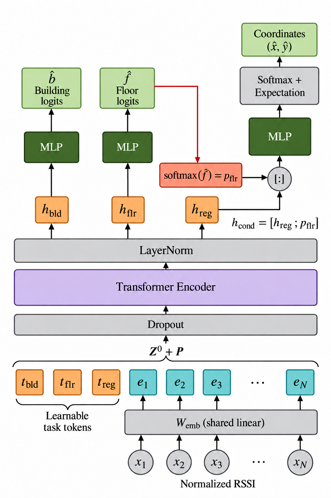

# WiTra: Lightweight Transformer for WiFi Indoor Localization

WiTra jointly predicts building identity, floor level, and 2D coordinates
from WiFi RSSI fingerprints. This repository contains the compact main
configuration and training/evaluation scripts for UJIIndoorLoc, UTS, and
Tampere (TUT).

## Repository layout

```text
witra-lightweight/
  README.md
  .gitignore
  assets/
    witra_architecture.png
  src/
    scripts/             # Main launchers, setup and data preparation
    model/               # Transformer encoder and prediction heads
    dataprocess/         # RSSI processing and dataset readers
    LibMTL/              # Original uncertainty-weighting implementation
    run.py                    # Command-line entry point
    trainer.py                # Training and validation-selected evaluation
    prepare_data.py           # Splitting and training-only TUT augmentation
    floor_protection.py
    uncertainty_weighting.py
    configurations.py
    checkpoint_sweep.py
    requirements.txt
    requirements-data.txt
```

Runtime files are grouped under `src/`. Imports, launcher paths and
source-hash inventories use the renamed files. `floor_protection.py` implements
floor-protect; `uncertainty_weighting.py` loads the original LibMTL UW algorithm.
`configurations.py` is a required import of the shared runner. The sweep helper
is also included in the runner's source hashes. These dependencies are retained
even though only the main-run launchers are provided.

## Architecture



The shared scalar embedding converts AP readings into tokens. Three learnable
task tokens pass through the shared Transformer encoder, and predicted floor
probabilities condition the coordinate decoder.

## Main configuration

All three launchers use the compact model: depth 2, embedding width 160,
FFN ratio 1, eight attention heads, three task tokens, attached floor
conditioning, expectation-based coordinate decoding, LibMTL uncertainty
weighting, and floor-protect. Training uses BF16, SDPA, AdamW, and 300 epochs.

| Dataset | Launcher in `src/scripts/` | Initial LR | Batch size |
|---|---|---:|---:|
| UJIIndoorLoc | `run_uji.sh` | 0.0008 | 32 |
| UTS | `run_uts.sh` | 0.0001 | 32 |
| Tampere (TUT) | `run_tut.sh` | 0.0001 | 16 |

The best checkpoint is selected by the lowest validation mean 2D localization
error across the training epochs; the earliest checkpoint wins a tie. Test
evaluation uses this same `best.pt`. The latest 100 epoch checkpoints are also
retained, as in the original main runs.

## Environment

Run from this folder on the Linux/CUDA server:

```bash
cd witra-lightweight
bash src/scripts/setup.sh
export WITRA_PYTHON="$PWD/src/.venv/bin/python"
export WITRA_DEVICE=cuda:0
```

The setup script uses Python 3.12, installs the pinned data dependencies and
PyTorch 2.8.0 with CUDA 12.8 wheels, and verifies CUDA availability. The main
launchers require a GPU supporting BF16. If you already use the `(sa)`
environment with the required dependencies, skip setup and use:

```bash
export WITRA_PYTHON="$(command -v python)"
export WITRA_DEVICE=cuda:0
```

The original LibMTL UW implementation and its base class are included, together
with the MIT license in `src/LibMTL/LICENSE`.

## Paths and prepared data

Raw datasets and previous run outputs are not included. Set an output root for
these new runs to override the launchers' historical default output roots:

```bash
export WITRA_RUNS="$PWD/runs"
export WITRA_PREPARED_ROOT=/absolute/path/to/WiTra_Direct_Prepared
```

If this repository is next to the existing `WiTra_Direct_Prepared`, set
`WITRA_PREPARED_ROOT="$PWD/../WiTra_Direct_Prepared"` from the repository root.
It must contain:

```text
WiTra_Direct_Prepared/
  uji_mean_center/{metadata.json,train.npz,val.npz,test.npz}
  uts_mean_center/{metadata.json,train.npz,val.npz,test.npz}
  tampere_mean_center/{metadata.json,train.npz,val.npz,test.npz}
```

Use the same prepared partitions for all training seeds. They contain
training-fitted AP filtering and coordinate bounds, mean-centered RSSI
features, and training-only KNN augmentation for TUT. Training and validation
fingerprints are split before fitting and augmentation.

If prepared data are unavailable, set the raw CSV root and prepare each dataset:

```bash
export WITRA_DATA_ROOT=/absolute/path/to/data/indoorloc
export WITRA_PREPARED_ROOT="$PWD/prepared"
bash src/scripts/prepare_data.sh uji mean_center
bash src/scripts/prepare_data.sh uts mean_center
bash src/scripts/prepare_data.sh tampere mean_center
```

The raw root must contain `uji_data/raw/trainingData.csv`,
`uji_data/raw/validationData.csv`,
`UTSIndoorLoc-dataset/uts_data/raw/UTS_training.csv`,
`UTSIndoorLoc-dataset/uts_data/raw/UTS_test.csv`, and the four Tampere files
`Training_rss.csv`, `Training_coordinates.csv`, `Test_rss.csv`, and
`Test_coordinates.csv` under `tampere_data/raw/`. Existing nonempty prepared
directories are preserved.

## Train and test

From the project root, train seed 42:

```bash
bash src/scripts/run_uji.sh train 42
bash src/scripts/run_uts.sh train 42
bash src/scripts/run_tut.sh train 42
```

Evaluate the validation-selected checkpoints:

```bash
bash src/scripts/run_uji.sh test 42
bash src/scripts/run_uts.sh test 42
bash src/scripts/run_tut.sh test 42
```

Replace `42` with `43` or `44` to run another training seed. If your current
directory is `src/scripts`, use the script filename directly. The
launchers execute from `src/`, so relative paths passed through environment
variables are resolved from `src/`. The examples above use absolute environment
paths to keep data and run locations independent of the caller's directory.

## Outputs

With `WITRA_RUNS` set above, run directories are:

```text
runs/uji/MAIN/seed_42/
runs/uts/MAIN/seed_42/
runs/tampere/MAIN/seed_42/
```

Each completed training run has `manifest.json`, `history.json`, `best.pt`, and
the recent epoch checkpoints under `checkpoints/`. Test evaluation adds
`metrics.json` and `predictions.csv` and prints `EVALUATION_COMPLETE`.
The manifest records configuration, software, data/source hashes, and the
selected epoch. Existing runs and evaluations are not overwritten. Use a new
output root for a fresh repeat of the same dataset and seed.

The launchers also retain their original `sweep` action. Its helper remains
because `run.py` hashes it and the main launchers call it. Use `test`
for the validation-selected result; a sweep is a separate exploratory report
and does not replace `best.pt` or `metrics.json`.

File renaming preserves the training algorithm and dataset settings.
The source hashes have changed: evaluate runs from the original folder
with that folder's original runner. Existing integrity checks remain enabled. `configurations.py` is an internal dependency of the
shared runner; this repository includes only the main-run launchers.
